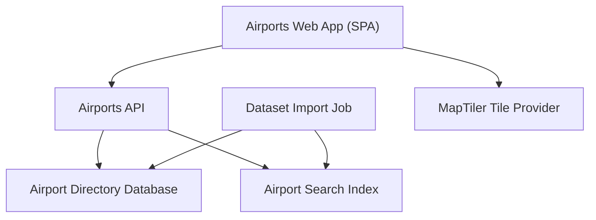
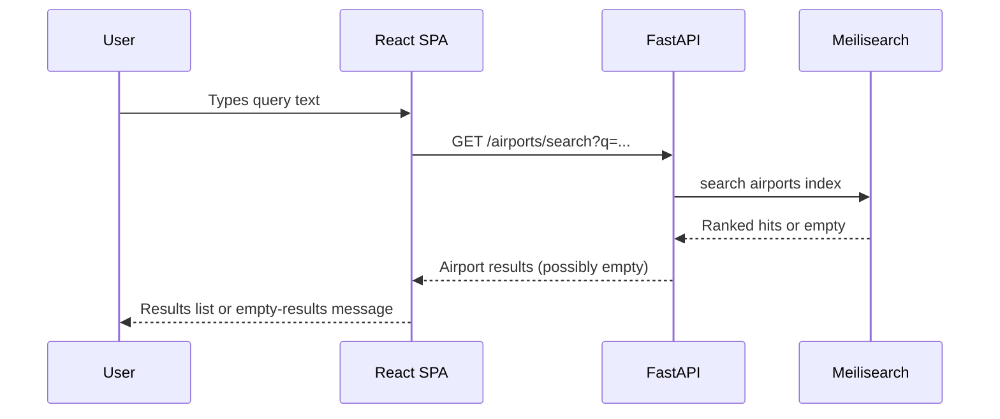
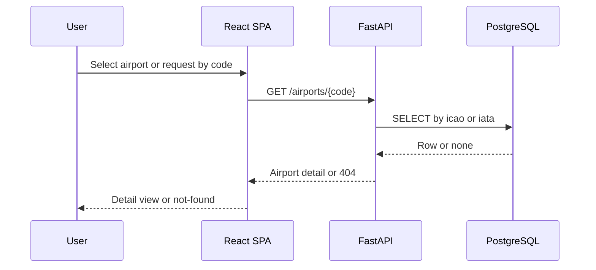
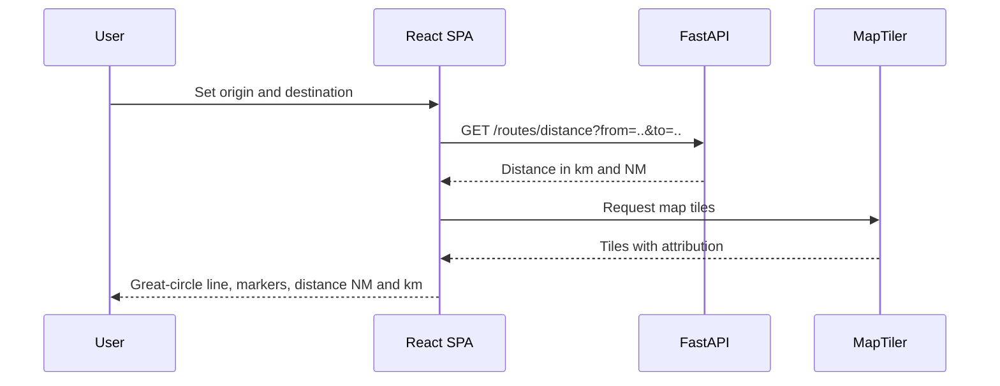
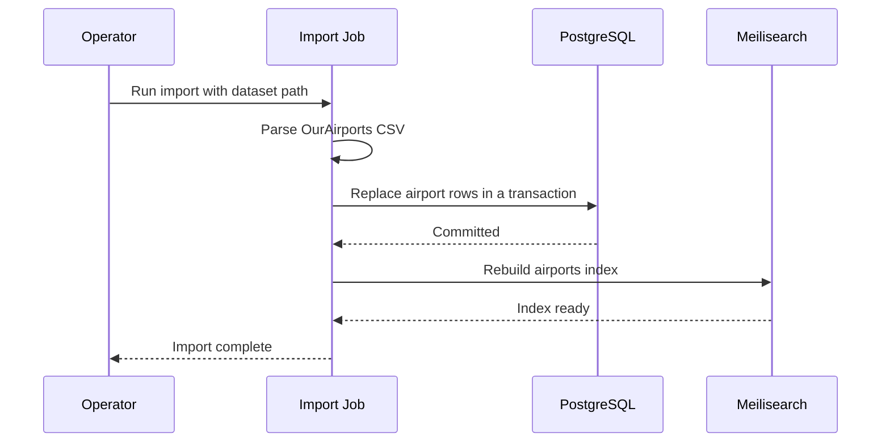
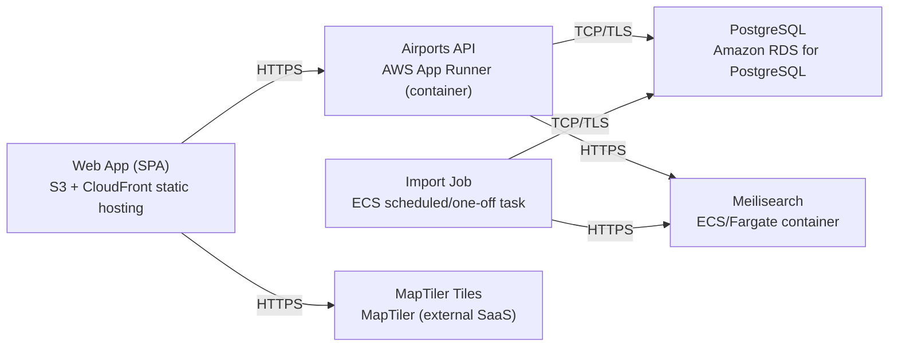

# Architecture

> Maintained by QuorQ AI SDLC. Text between `sdlc:auto` markers is regenerated; anything outside them is yours and is kept.

<!-- sdlc:auto:start narrative -->
## Overview

### ARCH-SUMMARY · approved · source: architecture:summary

Airports is a free, single-screen responsive web tool to search ~80,000 airports, view details, and plot great-circle routes with distance on a MapTiler-backed map.

React 19 SPA (with Leaflet) talks to a lean FastAPI 0.115 service that serves search/lookup and computes haversine distance. Airport data lives read-only in PostgreSQL 16, loaded from the bundled OurAirports open dataset and refreshed by clean re-import, indexed into Meilisearch for fast, typo-tolerant search. No accounts, no writes; search/lookup endpoints are intentionally public with no authentication. Hosted on AWS to scale down cheaply under unpredictable public traffic.

**Related:** REQ-STACK, REQ-SERVICES

### ARCH-COMP-FRONTEND · approved · source: architecture:component:frontend

Airports Web App (SPA), React 19.

Single responsive screen with search box, results list, airport detail view, origin/destination selection, and an interactive Leaflet map that draws the great-circle route with markers and shows distance in NM and km with map/data attribution.

**Related:** REQ-FEAT-SEARCH, REQ-FEAT-DETAILS, REQ-FEAT-ROUTE

### ARCH-COMP-API · approved · source: architecture:component:api

Airports API, FastAPI 0.115.

Public, no-auth HTTP service serving airport search (delegated to Meilisearch), single-airport lookup by code, and great-circle (haversine) distance computation for a selected origin/destination pair. Read-only - offers no create/update/delete of airport data.

**Related:** REQ-FEAT-API, ARCH-EP-SEARCH, ARCH-EP-LOOKUP, ARCH-EP-DISTANCE, ARCH-EP-HEALTH

### ARCH-COMP-IMPORTER · approved · source: architecture:component:importer

Dataset Import Job, FastAPI 0.115 codebase run as a CLI job.

Operator-run Python job that re-imports the bundled OurAirports dataset: cleanly replaces airport rows in PostgreSQL and (re)builds the Meilisearch index so the directory reflects the updated dataset with no in-app editing.

**Related:** REQ-FEAT-DIRECTORY, ARCH-CP-IMPORT

### ARCH-COMP-DB · approved · source: architecture:component:database

Airport Directory Database, PostgreSQL 16.

Stores the read-only worldwide airport directory (ICAO, IATA, name, city, country, coordinates) as the source of truth, re-imported on refresh and queried for airport lookup and detail.

**Related:** REQ-STACK, ARCH-ENTITY-AIRPORTS

### ARCH-COMP-SEARCH · approved · source: architecture:component:search

Airport Search Index, Meilisearch v1.10.3 (getmeili/meilisearch).

Typo-tolerant, type-as-you-go full-text search over ICAO code, IATA code, name, city, and country across the full directory, returning ranked matching airports instantly.

**Related:** REQ-SERVICES, NFR-001

### ARCH-COMP-MAPTILER · approved · source: architecture:component:maptiler

MapTiler Tile Provider, external SaaS tiles.

External map tile service providing background map imagery the browser renders under the great-circle route line and markers, with provider attribution.

**Related:** REQ-SERVICES, NFR-006

### ARCH-CP-SEARCH · approved · source: architecture:critical-path:search

Type-as-you-go airport search critical path.

User types part of a code, name, city, or country; the SPA queries the API, which forwards the query to Meilisearch for fast typo-tolerant matches and returns a result list. An empty match set returns an empty list with a success status, not an error.

**Related:** ARCH-COMP-FRONTEND, ARCH-COMP-API, ARCH-COMP-SEARCH

### ARCH-CP-DETAIL · approved · source: architecture:critical-path:detail-lookup

Airport detail lookup critical path.

User selects a result or a public consumer calls the lookup endpoint by ICAO or IATA code; the API reads the single airport from PostgreSQL and returns full details, or a not-found response when the code does not exist. Missing IATA is returned as empty, not a wrong value.

**Related:** ARCH-COMP-FRONTEND, ARCH-COMP-API, ARCH-COMP-DB

### ARCH-CP-ROUTE · approved · source: architecture:critical-path:route

Plot great-circle route and distance critical path.

With an origin and destination chosen, the SPA asks the API for the haversine distance, then draws a great-circle polyline and two markers on the Leaflet/MapTiler map and shows the distance in NM and km. Same origin and destination yields zero distance and a point rather than an error.

**Related:** ARCH-COMP-FRONTEND, ARCH-COMP-API, ARCH-COMP-MAPTILER

### ARCH-CP-IMPORT · approved · source: architecture:critical-path:import

Operator dataset re-import critical path.

Operator runs the import job pointing at a bundled OurAirports CSV; it parses rows, replaces the airport table transactionally, then rebuilds the Meilisearch index so search and lookup reflect the new data with no in-app editing.

**Related:** ARCH-COMP-IMPORTER, ARCH-COMP-DB, ARCH-COMP-SEARCH

### ARCH-ENTITY-AIRPORTS · approved · source: architecture:entity:airports

Single core entity: airports.

Fields: id, ident, icao_code, iata_code, name, municipality, iso_country, country_name, airport_type, latitude_deg, longitude_deg, imported_at.

**Related:** ARCH-COMP-DB

### ARCH-EP-SEARCH · approved · source: architecture:endpoint:GET /airports/search

GET /airports/search - search airports by code, name, city, or country.

Searches airports by ICAO code, IATA code, name, city, or country via Meilisearch; returns matching airports or an empty list on no match.

**Related:** REQ-FEAT-API

### ARCH-EP-LOOKUP · approved · source: architecture:endpoint:GET /airports/{code}

GET /airports/{code} - look up a single airport by ICAO or IATA code.

Looks up a single airport by a valid ICAO or IATA code and returns full details, or 404 if the code is not in the dataset.

**Related:** REQ-FEAT-API

### ARCH-EP-DISTANCE · approved · source: architecture:endpoint:GET /routes/distance

GET /routes/distance - compute great-circle distance between two airports.

Computes the great-circle (haversine) distance between two airports selected by code; returns distance in kilometres and nautical miles. Same origin and destination returns zero.

**Related:** REQ-FEAT-ROUTE

### ARCH-EP-HEALTH · approved · source: architecture:endpoint:GET /health

GET /health - liveness/readiness check.

Liveness/readiness check for the service and its dependencies.

### ARCH-DEPLOY · approved · source: architecture:deployment-nodes

Six deployment nodes planned on AWS plus external MapTiler.

- Web App (SPA): S3 + CloudFront static hosting, React 19 static build (Vite).
- Airports API: AWS App Runner (container), FastAPI 0.115 on Python/Uvicorn.
- Meilisearch: ECS/Fargate container, getmeili/meilisearch:v1.10.3.
- PostgreSQL: Amazon RDS for PostgreSQL 16.
- Import Job: ECS scheduled/one-off task, FastAPI 0.115 codebase run as a CLI job.
- MapTiler Tiles: MapTiler external SaaS, hosted tile API.

**Related:** ARCH-COMP-FRONTEND, ARCH-COMP-API, ARCH-COMP-SEARCH, ARCH-COMP-DB, ARCH-COMP-IMPORTER, ARCH-COMP-MAPTILER

### ARCH-TECH · approved · source: architecture:technology-decisions

Architecture confirms the approved stack and records alternatives considered for each choice.

- Frontend: React 19 (alternatives considered: Vue, Svelte) - handles the single interactive screen's component/state needs and pairs directly with Leaflet/MapTiler.
- Backend: FastAPI 0.115 (alternatives considered: Flask, Django REST Framework) - lean service for search delegation, lookup, and haversine distance; also hosts the import job.
- Database: PostgreSQL 16 (alternatives considered: SQLite, MySQL) - ~80,000 read-only rows store and re-import cleanly; answers lookup-by-code without extra moving parts.
- Cloud: AWS (alternatives considered: GCP, Azure) - serves the static SPA (S3/CloudFront), runs the API and Meilisearch container, hosts PostgreSQL (RDS), scales down cheaply for a free tool with no revenue.

**Related:** REQ-STACK
<!-- sdlc:auto:end narrative -->

<!-- sdlc:auto:start building-blocks -->
## Building Block View

| ID | Name | Technology | Responsibility | Depends on |
|---|---|---|---|---|
| frontend | Airports Web App (SPA) | React 19 | Single responsive screen with search box, results list, airport detail view, origin/destination selection, and an interactive Leaflet map that draws the great-circle route with markers and shows distance in NM and km with map/data attribution. | api, maptiler |
| api | Airports API | FastAPI 0.115 | Public, no-auth HTTP service that serves airport search (delegated to Meilisearch), single-airport lookup by code, and great-circle (haversine) distance computation for a selected origin/destination pair. Read-only - offers no create/update/delete of airport data. | database, search |
| importer | Dataset Import Job | FastAPI 0.115 | Operator-run Python job that re-imports the bundled OurAirports dataset: cleanly replaces airport rows in PostgreSQL and (re)builds the Meilisearch index so the directory reflects the updated dataset with no in-app editing. | database, search |
| database | Airport Directory Database | PostgreSQL 16 | Stores the read-only worldwide airport directory (ICAO, IATA, name, city, country, coordinates) as the source of truth, re-imported on refresh and queried for airport lookup and detail. | — |
| search | Airport Search Index | Meilisearch v1.10.3 (getmeili/meilisearch) | Typo-tolerant, type-as-you-go full-text search over ICAO code, IATA code, name, city, and country across the full directory, returning ranked matching airports instantly. | — |
| maptiler | MapTiler Tile Provider | MapTiler (external SaaS tiles) | External map tile service providing background map imagery the browser renders under the great-circle route line and markers, with provider attribution. | — |

<!-- sdlc:auto:end building-blocks -->

<!-- sdlc:auto:start runtime -->
## Runtime View

### Type-as-you-go airport search

User types part of a code, name, city, or country; the SPA queries the API, which forwards the query to Meilisearch for fast typo-tolerant matches and returns a result list. An empty match set returns an empty list with a success status, not an error.

- **Components:** frontend, api, search
- **Modules:** search_router, search_service, meili_client, schemas
- **Key functions:** search_airports(q, limit), meili_query(index, q, limit), to_airport_results(hits)

### Airport detail lookup

User selects a result or a public consumer calls the lookup endpoint by ICAO or IATA code; the API reads the single airport from PostgreSQL and returns full details, or a not-found response when the code does not exist. Missing IATA is returned as empty, not a wrong value.

- **Components:** frontend, api, database
- **Modules:** airports_router, airport_repository, schemas
- **Key functions:** get_airport_by_code(code), find_by_icao_or_iata(code), to_airport_detail(row)

### Plot great-circle route and distance

With an origin and destination chosen, the SPA asks the API for the haversine distance, then draws a great-circle polyline and two markers on the Leaflet/MapTiler map and shows the distance in NM and km. Same origin and destination yields zero distance and a point rather than an error.

- **Components:** frontend, api, maptiler
- **Modules:** routes_router, distance_service, map_view, geodesic_util
- **Key functions:** great_circle_distance(origin, destination), haversine_km(lat1, lon1, lat2, lon2), to_nm(km), buildGeodesicLine(a, b)

### Operator dataset re-import

Operator runs the import job pointing at a bundled OurAirports CSV; it parses rows, replaces the airport table transactionally, then rebuilds the Meilisearch index so search and lookup reflect the new data with no in-app editing.

- **Components:** importer, database, search
- **Modules:** import_job, ourairports_parser, airport_repository, meili_indexer
- **Key functions:** run_import(csv_path), parse_ourairports(csv_path), replace_airports(rows), reindex_meili(rows)

<!-- sdlc:auto:end runtime -->

<!-- sdlc:auto:start deployment-view -->
## Deployment View

| Name | Service | Runtime | Scaling | Environment |
|---|---|---|---|---|
| Web App (SPA) | S3 + CloudFront static hosting | React 19 static build (Vite) | CDN edge, scales to zero cost at low traffic | dev |
| Airports API | AWS App Runner (container) | FastAPI 0.115 on Python / Uvicorn | Auto-scales on request load, scales down cheaply when idle | dev |
| Meilisearch | ECS/Fargate container | getmeili/meilisearch:v1.10.3 | Single task for MVP with attached volume | dev |
| PostgreSQL | Amazon RDS for PostgreSQL | PostgreSQL 16 | Single small instance, read-heavy workload | dev |
| Import Job | ECS scheduled/one-off task | FastAPI 0.115 codebase run as a CLI job | On-demand, operator-triggered | dev |
| MapTiler Tiles | MapTiler (external SaaS) | Hosted tile API | Managed by provider, free tier | dev |

| Source | Target | Protocol |
|---|---|---|
| Web App (SPA) | Airports API | HTTPS |
| Web App (SPA) | MapTiler Tiles | HTTPS |
| Airports API | PostgreSQL | TCP/TLS |
| Airports API | Meilisearch | HTTPS |
| Import Job | PostgreSQL | TCP/TLS |
| Import Job | Meilisearch | HTTPS |

<!-- sdlc:auto:end deployment-view -->

<!-- sdlc:auto:start decisions -->
## Architecture Decisions

| Layer | Choice | ADR |
|---|---|---|
| Frontend | React 19 | [ADR-0001](adr/frontend.md) |
| Backend | FastAPI 0.115 | [ADR-0002](adr/backend.md) |
| Database | PostgreSQL 16 | [ADR-0003](adr/database.md) |
| Cloud | AWS | [ADR-0004](adr/cloud.md) |
<!-- sdlc:auto:end decisions -->

<!-- sdlc:auto:start links -->
## Related Documents

- [Data Model](data-model.md)
- [API Specification](api/openapi.yaml)
- [Architecture Decision Records](adr/README.md)
<!-- sdlc:auto:end links -->
