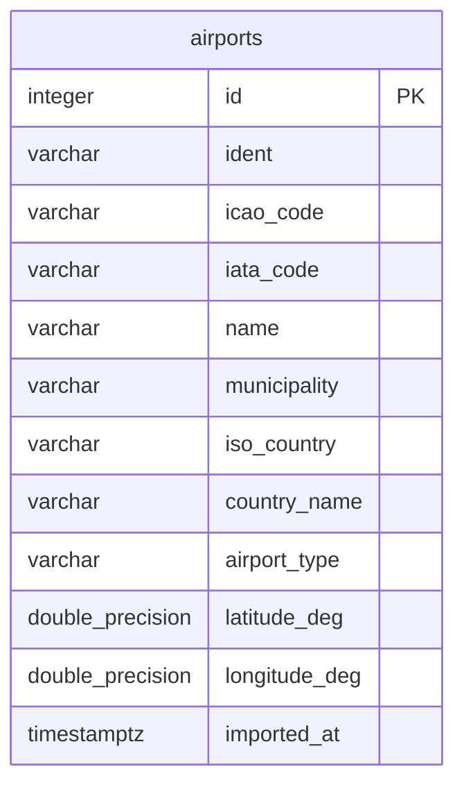

# Data Model

<!-- sdlc:auto:start entities -->
### airports

| Field | Type | PK | FK | Nullable |
|---|---|---|---|---|
| id | integer | True | — | False |
| ident | varchar | False | — | True |
| icao_code | varchar | False | — | True |
| iata_code | varchar | False | — | True |
| name | varchar | False | — | False |
| municipality | varchar | False | — | True |
| iso_country | varchar | False | — | True |
| country_name | varchar | False | — | True |
| airport_type | varchar | False | — | True |
| latitude_deg | double precision | False | — | False |
| longitude_deg | double precision | False | — | False |
| imported_at | timestamptz | False | — | False |
<!-- sdlc:auto:end entities -->

<!-- sdlc:auto:start relationships -->
_No relationships recorded._
<!-- sdlc:auto:end relationships -->

<!-- sdlc:auto:start er-diagram -->

<!-- sdlc:auto:end er-diagram -->
