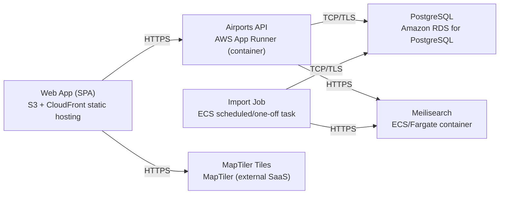

# Deployment Guide

> Maintained by QuorQ AI SDLC. Text between `sdlc:auto` markers is regenerated; anything outside them is yours and is kept.

<!-- sdlc:auto:start how-it-deploys -->
Pushes to `main` run `.github/workflows/deploy.yml`, which builds the API image (if there is a backend) and deploys the SPA to AWS Amplify. Commits touching only `docs/sdlc/**` don't deploy. Deployments can also be started from the platform's Deployment tab.
<!-- sdlc:auto:end how-it-deploys -->

<!-- sdlc:auto:start environments -->
| Name | Service | Runtime | Scaling | Environment |
|---|---|---|---|---|
| Web App (SPA) | S3 + CloudFront static hosting | React 19 static build (Vite) | CDN edge, scales to zero cost at low traffic | dev |
| Airports API | AWS App Runner (container) | FastAPI 0.115 on Python / Uvicorn | Auto-scales on request load, scales down cheaply when idle | dev |
| Meilisearch | ECS/Fargate container | getmeili/meilisearch:v1.10.3 | Single task for MVP with attached volume | dev |
| PostgreSQL | Amazon RDS for PostgreSQL | PostgreSQL 16 | Single small instance, read-heavy workload | dev |
| Import Job | ECS scheduled/one-off task | FastAPI 0.115 codebase run as a CLI job | On-demand, operator-triggered | dev |
| MapTiler Tiles | MapTiler (external SaaS) | Hosted tile API | Managed by provider, free tier | dev |
<!-- sdlc:auto:end environments -->

<!-- sdlc:auto:start live -->
_Not deployed yet._
<!-- sdlc:auto:end live -->

<!-- sdlc:auto:start topology -->

<!-- sdlc:auto:end topology -->
